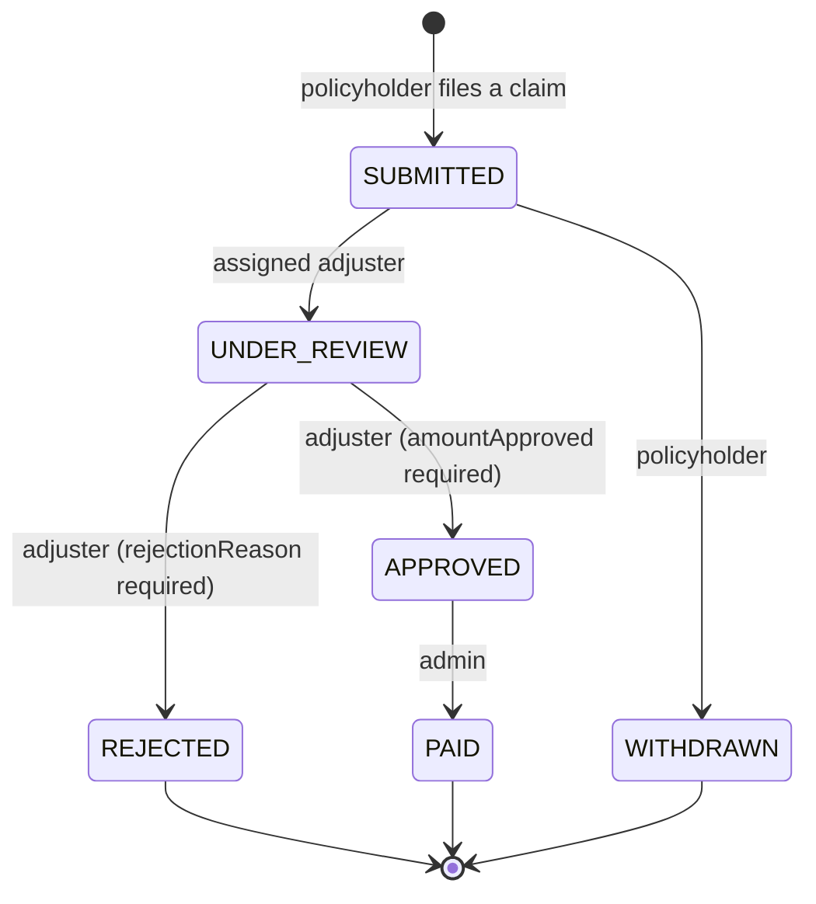
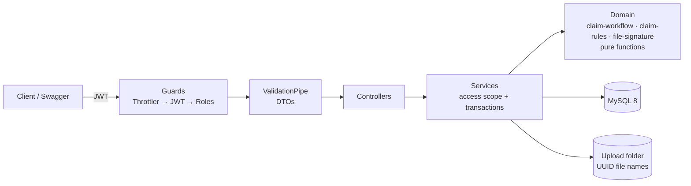
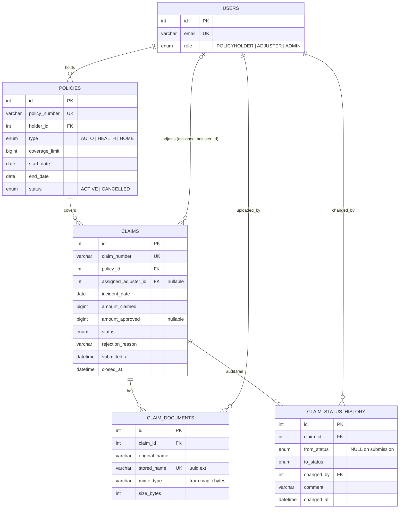

# ClaimFlow — Insurance Claims API

[](https://github.com/bilel-hmem/claimflow-insurance-api/actions/workflows/ci.yml)


Policyholders file claims with supporting documents; adjusters review them; admins pay them. Every move goes through **one explicit state machine**, every decision is **recorded in an audit timeline**, and nobody can see a claim that is not theirs.

## Why this project

Insurers need claim handling that is **controlled** (a paid claim can never go back to "submitted"), **authorised** (only the assigned adjuster decides, only finance pays) and **traceable** (who changed what, and when). ClaimFlow shows how to get all three with small, testable pieces:

- The whole workflow is a **single transition table**. A table-driven test checks **all 108 combinations** of current status × target status × role.
- **Row-level access control**: policyholders see their claims, adjusters only the claims assigned to them, admins everything. Anything else is a 404, so the API never confirms that someone else's claim exists.
- **Uploads are checked by content**, not by file name: a `.exe` renamed to `.pdf` is refused with 415.
- Two adjusters deciding at the same moment cannot both win: the claim row is locked, and the second decision gets a 409 (proven by an e2e test).

## The claim lifecycle



| Request | Answer |
|---|---|
| A move that does not exist (e.g. `SUBMITTED → PAID`) | **409** Conflict |
| A move that exists but your role cannot make it | **403** Forbidden |
| A claim you are not allowed to see | **404** Not Found |
| Approving more than claimed or than the coverage limit | **422** Unprocessable Entity |

Each claim response includes `availableTransitions` for the current user, so a front end knows which buttons to show.

## Features

- Sign-up for policyholders; admins create adjuster and admin accounts
- Policies (AUTO, HEALTH, HOME) with coverage limit and validity period; cancellation
- Claim submission rules: active policy, incident inside the policy period and not in the future, amount within coverage
- Assignment to adjusters, review, partial or full approval, rejection with reason, payment, withdrawal
- Audit timeline per claim (who, from → to, comment, when)
- Supporting documents: PDF/PNG/JPEG up to 5 MB, type detected from magic bytes, random file names on disk, secure download
- Filters and pagination: status, policy type, dates, adjuster, unassigned queue
- Admin report: claims per status, amounts claimed/approved/paid, average processing time
- JWT auth, role guards, validation, rate limiting, helmet, consistent errors, Swagger at `/docs`

## Architecture



The business rules live in `src/modules/claims/domain/` as **pure functions with no database or framework**, which is why they can be tested exhaustively in milliseconds.

```
src/
├── common/        # guards, decorators, exception filter, pagination, money helpers
├── config/        # Joi environment validation
├── database/      # data source, migrations, seed
└── modules/
    ├── auth/      # sign-up, login, JWT
    ├── users/     # staff accounts (admin)
    ├── policies/  # issue, list, cancel
    ├── claims/
    │   ├── domain/        # state machine, submission rules, file signatures (+ specs)
    │   ├── entities/      # claim, document, status history
    │   ├── claims.service.ts
    │   └── claim-documents.service.ts
    ├── reports/   # admin summary
    └── health/
test/              # e2e tests on a real MySQL
```

## Data model

Amounts are **integers in millimes** (1 TND = 1000), stored as `BIGINT`. CHECK constraints in the migration protect the data even if the code had a bug (positive amounts, approved ≤ claimed, end date after start date).



## Getting started

**Requirements:** Node.js 22+, Docker (for MySQL).

```bash
git clone https://github.com/bilel-hmem/claimflow-insurance-api.git
cd claimflow-insurance-api
npm ci
cp .env.example .env

docker compose up -d mysql     # MySQL 8 (also creates claimflow_test)
npm run migration:run
npm run seed                   # demo accounts, policies and claims
npm run start:dev              # http://localhost:3001/docs
```

### Demo accounts (password `Passw0rd!`)

| Email | Role | What to try |
|---|---|---|
| `amira@claimflow.tn` | POLICYHOLDER | 2 policies, 2 claims; file a new claim, upload a document, withdraw |
| `karim@claimflow.tn` | POLICYHOLDER | sees nothing of Amira's |
| `sami@claimflow.tn` | ADJUSTER | one claim under review: approve or reject it |
| `admin@claimflow.tn` | ADMIN | assign the waiting claim to Sami, pay approved claims, see the report |

## API examples

```bash
API=http://localhost:3001/api/v1
login() { curl -s -X POST $API/auth/login -H "Content-Type: application/json" \
  -d "{\"email\":\"$1\",\"password\":\"Passw0rd!\"}" | jq -r .accessToken; }
AMIRA=$(login amira@claimflow.tn); SAMI=$(login sami@claimflow.tn); ADMIN=$(login admin@claimflow.tn)

# Amira files a claim (amounts in millimes: 1 850 TND)
curl -s -X POST $API/claims -H "Authorization: Bearer $AMIRA" -H "Content-Type: application/json" \
  -d '{"policyId":1,"incidentDate":"2026-11-20","description":"Windshield cracked by a stone on the A1 motorway.","amountClaimed":1850000}'

# ...attaches a photo
curl -s -X POST $API/claims/3/documents -H "Authorization: Bearer $AMIRA" -F "file=@windshield.jpg"

# The admin assigns it, Sami reviews and approves 1 500 TND
curl -s -X PATCH $API/claims/3/assign -H "Authorization: Bearer $ADMIN" -H "Content-Type: application/json" -d '{"adjusterId":2}'
curl -s -X PATCH $API/claims/3/status -H "Authorization: Bearer $SAMI" -H "Content-Type: application/json" -d '{"status":"UNDER_REVIEW"}'
curl -s -X PATCH $API/claims/3/status -H "Authorization: Bearer $SAMI" -H "Content-Type: application/json" \
  -d '{"status":"APPROVED","amountApproved":1500000,"comment":"Deductible applied"}'

# Full history
curl -s $API/claims/3/timeline -H "Authorization: Bearer $AMIRA"
```

| Method | Endpoint | Who | Description |
|---|---|---|---|
| POST | `/auth/register` | public | Policyholder sign-up |
| POST | `/auth/login` | public | JWT (10 attempts/min) |
| GET | `/auth/me` | any | Current user |
| POST / GET | `/users` | admin | Create staff, list users (`?role=ADJUSTER`) |
| POST | `/policies` | admin | Issue a policy |
| GET | `/policies`, `/policies/:id` | any | Own policies (holder) or all (staff) |
| PATCH | `/policies/:id/cancel` | admin | Cancel |
| POST | `/claims` | policyholder | File a claim |
| GET | `/claims` | any | Scoped list: `status`, `type`, `policyId`, `from`, `to`, `adjusterId`, `unassigned` |
| GET | `/claims/:id` | any | Claim + `availableTransitions` |
| PATCH | `/claims/:id/assign` | admin | Assign an adjuster |
| PATCH | `/claims/:id/status` | depends | Workflow move |
| GET | `/claims/:id/timeline` | any | Audit trail |
| POST / GET | `/claims/:id/documents` | any | Upload (multipart `file`) / list |
| GET | `/claims/:id/documents/:docId/download` | any | Download |
| GET | `/reports/claims-summary` | admin | Counts, amounts, avg processing days |
| GET | `/health` | public | Liveness + DB ping |

## Tests

```bash
npm test            # 150+ unit tests, including all 108 workflow combinations
npm run test:e2e    # 27 e2e tests on a real MySQL (claimflow_test)
```

E2E highlights: the full lifecycle with an uploaded PDF downloaded back byte-for-byte; every submission rule; 409 vs 403 vs 404; partial approval limits; two simultaneous decisions (one wins, one gets 409, the timeline has a single decision); spoofed file (415); file over 5 MB (413); no documents on closed claims.

## Design decisions

- **One transition table instead of `if` statements spread across services.** Adding a status means editing one object, and the exhaustive test immediately shows every new combination.
- **Pure domain functions.** Workflow, submission rules and file detection know nothing about HTTP or the database, so they are tested without mocks.
- **404 instead of 403 for other people's data**, and access scope applied inside the SQL query (not after loading), so pagination totals never leak.
- **Pessimistic lock on status changes.** Decisions are rare but must be exclusive; a lock is simpler and safer than retry logic.
- **Append-only history** written in the same transaction as the status change: the audit trail can never disagree with the claim.
- **Uploads:** content sniffing (magic bytes), server-generated UUID names, 5 MB limit enforced while streaming, and the DB row and file are kept consistent (file removed if the insert fails).

## Future improvements

- Store documents in S3-compatible object storage with signed URLs
- Email notifications on status changes (outbox pattern)
- SLA tracking: flag claims under review for more than N days
- Fraud signals (many claims on one policy, claims right after policy start)
- Refresh tokens and account lockout

## License

[MIT](LICENSE)
